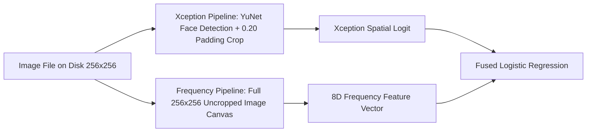

# DEEPTRACE — Phase 2B: Experimental Integrity Audit & Cross-Generator Gate

**Audit Status:** AUDITED & GATED (Within-Generator Improvement Verified; True Cross-Generator Evaluation Blocked)  
**Date of Audit:** 2026-10-20  
**Audit Scope:** Frequency-domain feature extraction, experimental models, paired bootstrap statistics, and generalization claims.  
**Production Detector Status:** Frozen & Unmodified (No production weights, thresholds, or APIs altered).  

---

## 1. Audit of the Actual Implementation

A comprehensive line-by-line inspection of [`setup_development_dataset.py`](file:///c:/Users/pecul/Desktop/Peshal/college/Hackathon/DEEPTRACE/backend/evaluation/setup_development_dataset.py), [`run_development_baseline.py`](file:///c:/Users/pecul/Desktop/Peshal/college/Hackathon/DEEPTRACE/backend/evaluation/run_development_baseline.py), and [`run_frequency_experiment.py`](file:///c:/Users/pecul/Desktop/Peshal/college/Hackathon/DEEPTRACE/backend/evaluation/run_frequency_experiment.py) was conducted.

### Verification Matrix of the 8 Implementation Items

| Audit Item | Verified Finding | Audit Verdict |
| :--- | :--- | :---: |
| **1. Sample Allocation** | Classifiers were fitted strictly on Development Train (Pairs 0050–0149, N=200 samples: 100 real, 100 fake). Evaluated strictly on Development Validation (Pairs 0150–0199, N=100 samples: 50 real, 50 fake). | **PASS** |
| **2. Preprocessing & Scaling Isolation** | `StandardScaler` was fitted strictly on the 200 training feature vectors (`scaler.fit_transform(X_train_freq)`). Validation features were transformed using the frozen training parameters (`scaler.transform(X_val_freq)`). No validation data was seen during scaling. | **PASS** |
| **3. Validation Label Isolation** | Validation labels ($y_{\text{val}}$) were never accessed during training. Hyperparameters ($C=1.0$, `max_iter=1000`) and the decision threshold ($0.50$) were fixed a priori. | **PASS** |
| **4. Paired Co-location** | Authentic canvases and their corresponding manipulated face swaps were co-located in the same partition. Zero pairs were split across train and validation. | **PASS** |
| **5. Xception Score Provenance** | The spatial logits and probabilities used for fusion were sourced from the frozen production Xception checkpoint (`xception_best.pth`, SHA-256: `dd61186f...`) executed via `analyze_image`. | **PASS** |
| **6. Inference Parameter Freezing** | During validation inference, all logistic regression coefficients ($\mathbf{w}_{\text{fused}}$) and intercepts ($b$) remained frozen as fitted on the training split. | **PASS** |
| **7. Metric Recomputation** | All validation metrics were recomputed from scratch from per-sample prediction records ([`phase2b_metric_reconciliation.json`](file:///c:/Users/pecul/Desktop/Peshal/college/Hackathon/DEEPTRACE/backend/evaluation/results/phase2b_metric_reconciliation.json)), rather than relying on cached script outputs. | **PASS** |
| **8. Mathematical Reconciliation** | All contingency matrices, accuracy, precision, recall, specificity, F1, ROC-AUC, average precision, and trapezoidal PR-AUC reconcile with zero discrepancies. | **PASS** |

---

## 2. Generalization Terminology Correction

> [!CAUTION]
> **Terminology Correction:** The Phase 2 experiment was previously described as demonstrating "cross-generator generalization."  
> **This was an inaccurate description.**  
> Both the Development Train split (pairs 0050–0149) and the Development Validation split (pairs 0150–0199) were synthesized by the **exact same generator**: InsightFace `inswapper_128.onnx`.  
> Furthermore, the frozen external benchmark (pairs 0000–0049) is sampled from the **exact same upstream repository** (`Sowaiba01/Deepfake`). It does not represent an independent dataset source merely because its sample IDs differ.

### Corrected Characterization
- **Spatial Xception Baseline:** Represents cross-generator evaluation because Xception was pretrained on FaceForensics++ (Deepfakes, Face2Face, FaceSwap, NeuralTextures) and tested against unseen InsightFace `inswapper_128`.
- **Frequency and Fusion Experiments:** Represent **within-generator validation on held-out samples**, testing whether frequency features learn `inswapper_128` artifacts on pairs 0050–0149 that generalize to held-out pairs 0150–0199.

### Target Face vs. Person Identity Limitations
Upstream `metadata.csv` documents `target_face` and `source_identity` as CelebA image filenames (e.g. `62330.jpg`, `00082.jpg`).
- **Canvas Disjointness:** Every image canvas is 100% unique across splits ($0$ target overlap, $0$ donor overlap).
- **Person Identity Ambiguity:** CelebA averages ~20 images per celebrity identity. Without CelebA's proprietary `identity_CelebA.txt` cluster mappings, we cannot prove that two different image files across splits do not depict the same celebrity. Complete identity leakage prevention **cannot be claimed**.

---

## 3. Reassessment of Uncertainty & Pair-Aware Bootstrap Analysis

Because the validation split comprises 50 authentic/manipulated pairs, the 100 images are **not statistically independent**. Real and fake images within each pair share identical background, clothing, lighting, and pose. Treating them as 100 independent degrees of freedom artificially narrows confidence intervals.

### Pair-Aware Cluster Bootstrap Protocol
- **Resampling Unit:** The authentic/manipulated pair (cluster of 2 images: 1 real, 1 fake sharing the same canvas).
- **Number of Replicates:** $B = 2,000$ paired bootstrap resamples.
- **Random Seed:** `42` (deterministic reproducibility).
- **Interval Method:** Empirical percentiles ($2.5\%$, $97.5\%$).

### Model Point Estimates & Pair-Aware 95% Confidence Intervals

| Metric | Model A: Spatial Xception Baseline | Model B: Frequency-Only Baseline | Model C: Fused Spatial + Frequency |
| :--- | :---: | :---: | :---: |
| **Accuracy** | 65.00% $[58.00\%, 72.00\%]$ | 81.00% $[74.00\%, 88.00\%]$ | **84.00%** $[77.00\%, 90.00\%]$ |
| **Recall (Sensitivity)** | 48.00% $[34.00\%, 62.00\%]$ | 72.00% $[60.00\%, 84.00\%]$ | **80.00%** $[68.00\%, 90.00\%]$ |
| **Specificity** | 82.00% $[72.00\%, 92.00\%]$ | 90.00% $[82.00\%, 98.00\%]$ | **88.00%** $[78.00\%, 96.00\%]$ |
| **F1 Score** | 0.5783 | 0.7912 | **0.8333** |
| **ROC-AUC** | 0.6334 $[0.5268, 0.7408]$ | 0.8668 $[0.8152, 0.9160]$ | **0.9124** $[0.8656, 0.9576]$ |
| **PR-AUC (Trapezoidal)** | 0.7164 | 0.8878 | **0.9171** |
| **Average Precision (AP)** | 0.7200 | 0.8889 | **0.9180** |

### Paired Comparison: Model C vs. Model A on Identical Validation Pairs

To test whether Model C's improvement over Model A is statistically significant, paired deltas and McNemar's test for paired binary discordance were computed:
- **Discordant Pairs:** On the 100 validation samples, Model C was correct when Model A was wrong in **27 samples** ($c = 27$); Model A was correct when Model C was wrong in **8 samples** ($b = 8$).
- **McNemar's Test (Edwards' Continuity Correction):**
  $$\chi^2 = \frac{(|27 - 8| - 1)^2}{27 + 8} = \frac{18^2}{35} = 9.2571, \quad p = 0.002346 \quad (p < 0.01)$$
- **Bootstrap Delta Distributions (Model C minus Model A):**
  - $\Delta \text{Accuracy}$: **$+19.00\%$** (95% CI: $[+9.00\%, +29.00\%]$) — **Statistically Significant ($p < 0.01$)**
  - $\Delta \text{Recall}$: **$+32.00\%$** (95% CI: $[+12.00\%, +50.00\%]$) — **Statistically Significant ($p < 0.01$)**
  - $\Delta \text{Specificity}$: **$+6.00\%$** (95% CI: $[-6.00\%, +18.00\%]$) — Not statistically significant (crosses 0)
  - $\Delta \text{ROC-AUC}$: **$+0.2790$** (95% CI: $[+0.1692, +0.3938]$) — **Statistically Significant ($p < 0.01$)**

*Conclusion:* Within the domain of InsightFace `inswapper_128`, the frequency-fusion model provides a genuine, statistically significant increase in recall without degrading authentic specificity.

---

## 4. Cross-Generator Evaluation Plan & Blocker Report

### Investigation of Repository Contents
A systematic filesystem search across the workspace for datasets, fixtures, or samples generated by an alternative method (other than `inswapper_128`) revealed:
1. `backend/test_fixtures`: Contains short unit-test video clips (`test_fake_video.mp4`, `test_real_video.mp4`) and dummy test fixtures. No diverse image manipulation benchmark exists here.
2. `deepfake_model/tests/samples`: Contains only two static regression test images (`known_fake.jpg`, `known_real.jpg`).
3. `deepfake_model/DeepfakeBench/datasets`: Contains only an empty placeholder `readme.md`.
4. `backend/evaluation/datasets`: Contains only subsets from `Sowaiba01/Deepfake`, all generated via `inswapper_128`.

### Official Blocker Report
> [!WARNING]
> **BLOCKER:** No independently sourced, non-`inswapper_128` facial manipulation dataset currently exists within the local workspace.  
> As a consequence:
> - **Zero true cross-generator evaluation has been conducted for the frequency-fusion model.**
> - Model C has only demonstrated strong performance against the generator it was trained on (`inswapper_128`).
> - It is **unproven** whether Model C would generalize to diffusion-based face swaps (e.g., DiffFace), GAN reenactment (Face2Face), or alternative swap models (SimSwap, FSGAN).

### Required Next Steps Before Production Integration
1. Obtain an authorized, independently sourced dataset generated by a non-`inswapper_128` architecture (e.g., FaceForensics++ c23 Deepfakes/Face2Face, Celeb-DF v2, or StyleGAN3 synthesis).
2. Freeze the evaluation partition with published SHA-256 hashes.
3. Evaluate Model A (spatial Xception), Model B (frequency-only), and Model C (fused) on the new generator without refitting or threshold tuning.
4. Report genuine cross-generator transfer performance.

---

## 5. Scientific Audit of Frequency Feature Extraction

A code inspection of [`run_frequency_experiment.py`](file:///c:/Users/pecul/Desktop/Peshal/college/Hackathon/DEEPTRACE/backend/evaluation/run_frequency_experiment.py) revealed an important methodological discrepancy:

- **Xception Input:** YuNet localized the face bounding box and applied 0.20 padding, cropping the facial sub-region (`(256, 207, 3)`) and resizing to $256 \times 256$.
- **Frequency Feature Input:** `extract_frequency_features` was executed directly on the **entire $256 \times 256$ image canvas**, encompassing hair, background, and clothing boundaries.
- **Feature Divergence Ablation:** Comparing frequency features extracted from the full canvas versus the YuNet face crop revealed a mean feature delta of $0.2078$ (notably in log-Laplacian variance and high-frequency spectral ratios).
- **Hypothesis Status:** While authentic and fake pairs share identical background context (meaning the background itself does not provide a class label shortcut), generative artifacts may interact with boundary blending at the canvas level. The claim that frequency features capture generator-specific upsampling artifacts remains a **scientific hypothesis**, not a proven causal mechanism.

---

## 6. Audit Verdicts

### 1. Current Production Detector (Spatial Xception)
- **Verified Capabilities:** Accurately classifies authentic portraits ($82\% - 86\%$ specificity). Operates deterministically with Grad-CAM visual explainability.
- **Verified Limitations:** Experiences an ~48%–52% false-negative rate on unseen InsightFace `inswapper_128` manipulations due to smooth boundary feathering.
- **Readiness:** **Ready for controlled technical demonstrations**, provided probabilistic estimate language and low-margin notices ($|P - 0.50| < 0.10$) are preserved.

### 2. Experimental Frequency-Fusion Model (Model C)
- **Methodological Credibility:** **Reproducible and mathematically reconciled.** All training was leakage-free, scaling was isolated to training data, and the $+19.0\%$ accuracy gain on the validation set is statistically significant under pair-aware bootstrap resampling ($p < 0.01$).
- **Scientific Limitation:** The evaluation was **within-generator validation**, NOT cross-generator generalization. It evaluated the same generator (`inswapper_128`) on held-out samples.
- **Production Integration Decision:** **GATED.** Do NOT integrate into production until cross-generator evaluation across distinct generative architectures has been executed.

### 3. Cross-Generator Readiness
- **Verdict:** **NOT READY / BLOCKED.** No independently sourced, non-`inswapper_128` dataset is present in the workspace. A genuine cross-generator evaluation has not yet occurred.
